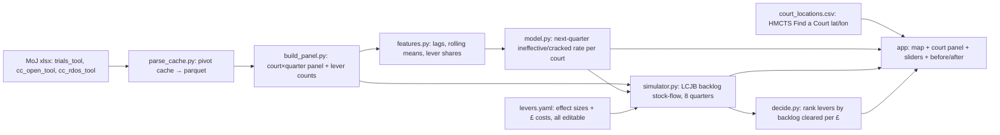

# Courtfall – build plan (engine → UI), hints not code

One-liner for judges: *"Courtfall predicts which Crown Courts will waste trial days next quarter, why, and which fix clears the backlog fastest per pound – on real MoJ data."*

## Architecture

Pick ONE app route: **Streamlit + pydeck/folium** (fastest, all Python) or FastAPI + React + Leaflet (prettier, 2x the work). For 24h with 3 people, Streamlit unless one teammate already knows React well.

## Files
```
oxhack/
  data/                 raw xlsx (done)
  parse_cache.py        done – xlsx → parquet
  build_panel.py        done – court_quarter.parquet
  court_locations.csv   done – 68 courts lat/lon
  baseline.py           done – naive vs LightGBM
  features.py           you
  model.py              you – trains, saves predictions_next_q.parquet
  simulator.py          you – pure functions, no UI
  decide.py             you
  levers.yaml           you – assumptions in one visible place
  app.py                you – Streamlit
```

## Layer by layer

### 1. Data cleaning (done – read it to understand)
- MoJ "tools" are Excel pivot tables; the raw rows live in `xl/pivotCache/pivotCacheRecords1.xml`. Each cell is either a value or an index into a shared list in the definition file. That's all parse_cache does.
- Filter: court_type = Crown, offence_group = "00: All offences" (otherwise you double count – the other groups are subsets), drop "Unknown" court.
- Check yourself: national ineffective rate per year should give ~16% 2019, ~27% 2023 (NAO figure). If not, you double counted.
- Learn: pandas pivot_table, why rates need the right denominator (listed_on_day = effective+cracked+ineffective; vacated were removed in advance so exclude).

### 2. Features
- Per court, sorted by time: lag1..lag4 of ineffective_rate, rolling-4 mean, last cracked rate, log volume, last-quarter share of each lever reason, quarter-of-year.
- Join area backlog from cc_open (by lcjb_area, "01. All open cases", "00: All offences", age "Total cases") lagged 1 quarter – likely your best new feature.
- Hint: always `groupby('court').shift(k)` – never shift across courts. Any feature at time t must only use info from ≤ t-1 (leakage check).

### 3. Prediction model
- Target: ineffective_rate next quarter (repeat for cracked_rate). Weight rows by trials listed (big courts matter more, small ones are noisy).
- Split by time: train ≤2023, test 2024Q1–2026Q2. Never random split.
- Baselines you must beat (already measured): last quarter 5.15pp, 4-quarter mean 4.49pp weighted MAE. Current best: blend 4.45pp. Honest.
- Ideas to try (one at a time, keep a results table): predict the residual vs rolling mean; drop 2020–22 or flag it; add area backlog; predict counts with Poisson objective instead of rates.
- Top causes: for each court, the predicted rate × last-4-quarter lever shares → "expected ineffective trials by cause next quarter". Simple and explainable.
- Judges line: "time-based holdout, beats the naive baseline, here's the error bar."

### 4. Backlog simulator (stock-flow, per LCJB area)
State each quarter: `backlog[t+1] = backlog[t] + receipts[t] − disposals[t]`.
- receipts: from cc_rdos_tool (download next) – project with last-4-quarter average (or a slider "+x% charges").
- disposals ≈ capacity: `disposals = sitting_days_area × disposals_per_day`. Calibrate disposals_per_day from history (area disposals ÷ area's share of national sitting days). Name the assumption.
- Wasted days: `effective_days = sitting_days × (1 − wasted_share)`, where wasted_share comes from predicted ineffective rate × fraction of an ineffective trial that is a truly lost day (slider, default e.g. 0.5 – floaters often fill gaps; say so).
- Run 8 quarters for "do nothing" and "with levers"; the gap is your before/after.
- Sanity: run it on 2022–2024 history and see if it roughly tracks real backlog. Show that chart to judges.

### 5. Lever effects (levers.yaml)
Each lever = which reason codes it shrinks + by how much (slider %) + cost.
| Lever | Shrinks | Cost input |
|---|---|---|
| Extra sitting days | capacity directly | £3,036/day (HMCTS, PQ 4727) |
| Cut overlisting | code 24 (but fewer listings → watch cracked gaps; keep simple: reduces overlisting losses) | ~£0 admin – say so |
| Defence advocates | codes 19,20,21 | assumed £ (national £34m/yr advocate uplift is context, not per court) |
| Video links / escorts | code 14 | assumed £ |
| Prosecution/witness readiness | ineffective 1–6,15,16; cracked 7,8 | assumed £ |
Recovered trials → recovered days → extra disposals in the simulator.

### 6. Decision / ranking
- For each court (via its area), for each lever at a fixed step (e.g. "fix 25% of that cause" or "+5% days"): backlog reduction after 8 quarters ÷ £ cost. Rank. Show top lever + "months sooner backlog peaks/falls".
- Levers with £0 cost → rank by days recovered instead (don't divide by zero; show "free win").
- Explain: "We don't tell the court what to do, we show the cheapest days on the table."

### 7. API (only if React)
- `GET /courts` → id, name, lat, lon, predicted rate, top cause. `GET /court/{id}` → history + causes. `POST /simulate` body = lever settings → two backlog series + ranking. Keep the simulator pure so Streamlit and FastAPI both call it.

### 8. UI
- Map: circle per court, colour = predicted ineffective rate, size = trials listed. (folium/pydeck in Streamlit; Leaflet CircleMarker in React.)
- Click → side panel: history line chart (actual vs predicted), cause bar chart, recommended lever with £ and days.
- Sliders: 5 levers + "receipts growth" + "lost-day fraction" assumption.
- Before/after: two lines on one chart (do-nothing vs with-levers), plus a big number "backlog −N cases, £X, M months sooner".
- Optional wow: "close this court" → move its trials to nearest 2 courts (haversine on lat/lon) and rerun.

## Ordered build steps (check at each)
1. Run parse/build scripts; reproduce the yearly national rates. ✅ check: 16%/27%.
2. Download cc_rdos_tool; parse with parse_cache; build area×quarter receipts/disposals/open. ✅ check: national open caseload ≈ 79k (Feb 2026 statement says "over 79,000").
3. features.py + model.py; reproduce baseline table, then try one improvement. ✅ check: test MAE vs 4.49pp.
4. Map with static colours from predictions. ✅ check: all 68 dots in the right places.
5. simulator.py on one area, do-nothing; backtest on history. ✅ check: plausible vs actual.
6. Add levers + ranking. ✅ check: turning a lever to 0 gives exactly the do-nothing line.
7. Wire sliders + before/after. 8. Polish, record a backup demo video.

## 24h timeline (3 people)
| Hours | Person A – data/model | Person B – simulator/decision | Person C – UI |
|---|---|---|---|
| 0–2 | run scripts, sanity checks | download cc_rdos, area tables | Streamlit skeleton + map from court_locations |
| 2–8 | features, model, results table | stock-flow sim + backtest | court panel, charts with dummy data |
| 8–10 | sleep/rotate | sleep/rotate | sleep/rotate |
| 10–16 | predictions parquet, top causes | levers.yaml, ranking | wire real predictions, sliders |
| 16–20 | error analysis, model card slide | close-court ripple (optional) | before/after chart, big numbers |
| 20–22 | freeze code, all help debug | | backup video |
| 22–24 | pitch rehearsal x3 | | |

## Explaining to judges (one sentence each)
- Data: "Official MoJ court statistics, every Crown Court trial outcome since 2016, with 63 reasons why."
- Model: "Predicts each court's failure rate next quarter, tested on 2024–26 it never saw, beats 'same as last time'."
- Simulator: "Backlog = last backlog + new cases − cases finished; wasted days shrink 'finished'."
- Levers: "Each lever removes real recorded failure reasons; the size is a slider because nobody knows it exactly – we're honest."
- Decision: "Ranks fixes by backlog cleared per pound, using HMCTS's £3,036 cost of a sitting day."
- Limits slide: area-level backlog, national sitting days, aggregate not per-trial – shows maturity.
