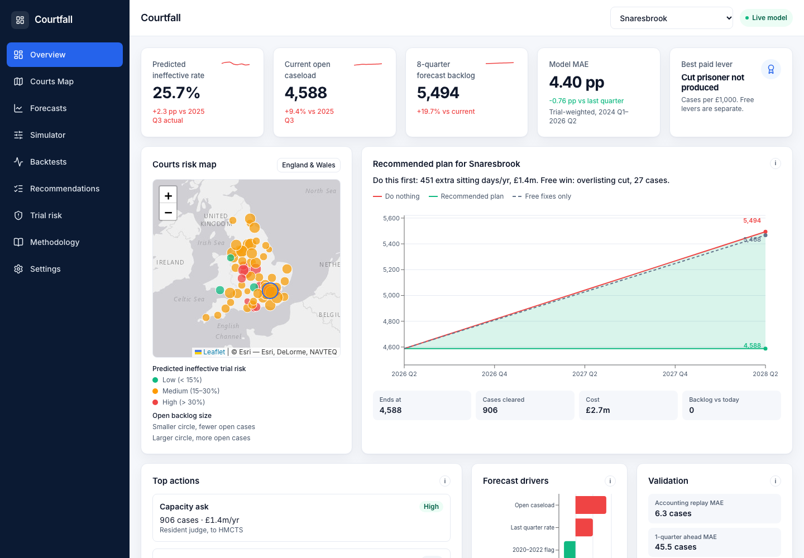
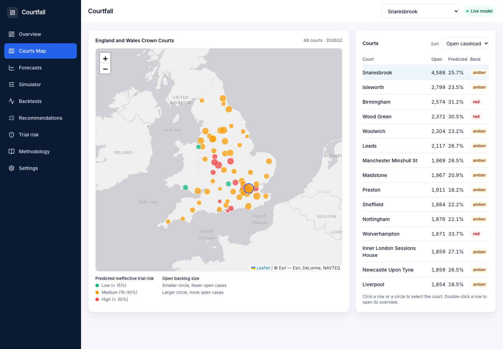
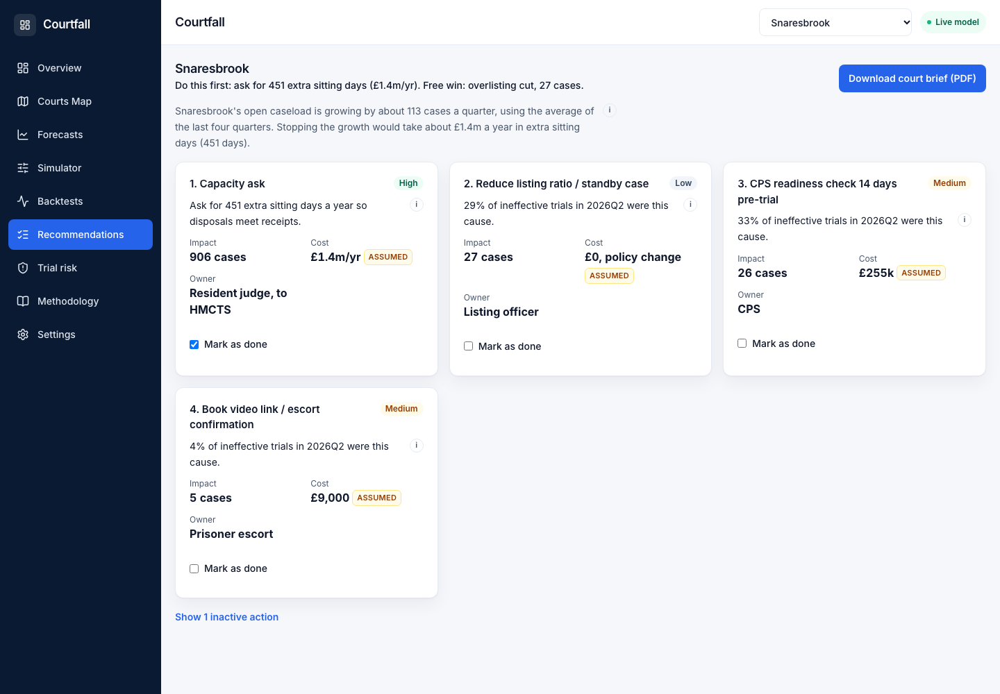
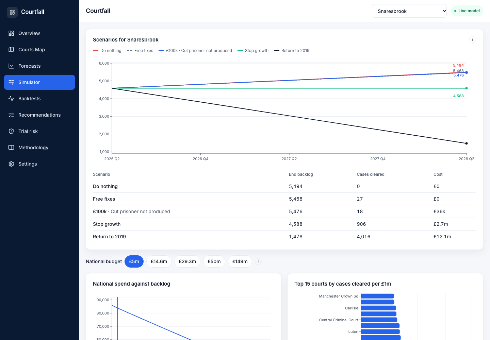
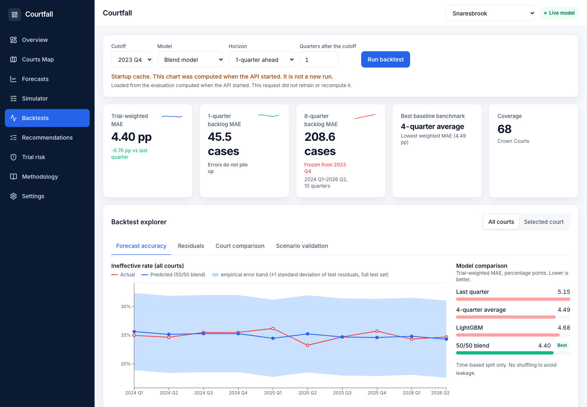
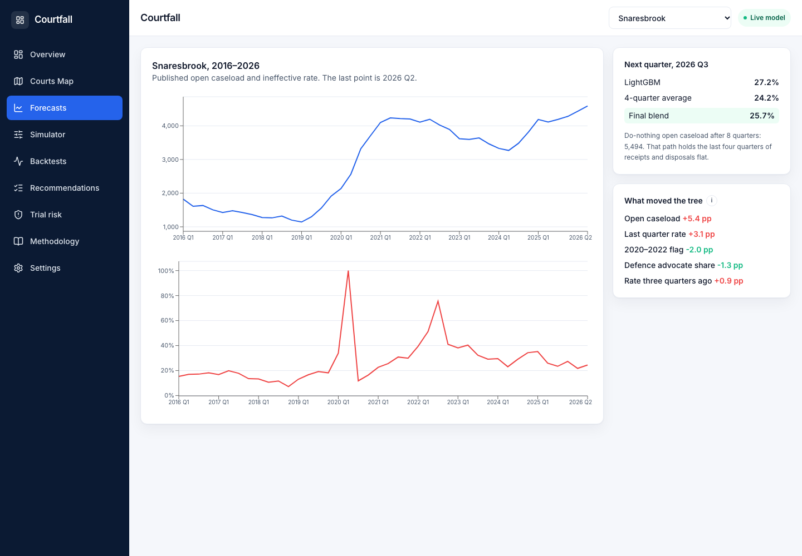

# Courtfall ⚖️

**A decision tool for England & Wales Crown Court backlogs.** Pick a court and Courtfall tells you what to do first, what it costs and how much backlog it clears. It's built only on official Ministry of Justice statistics for 68 Crown Courts.

Built at **OxHack 2026**.



## The problem
Crown Court open cases are around **80,700** (2026 Q2). About a quarter of listed trials are *ineffective*: they don't go ahead on the day because of prosecution or witness problems, overlisting, prisoners not produced, missing advocates or no judge. Money and judge time are limited, so the real question is **where to spend and on what**.

## What it decides
| Who | Decision |
|---|---|
| HMCTS / MoJ | Where a national sitting-day budget goes, court by court |
| Resident judge | Which actions to take first at their court |
| Listing officer | Which upcoming trials are at risk and need intervention |

**Key finding:** at all 68 courts, extra sitting days (capacity) clear more cases per pound than fixing collapsed trials. Stopping national backlog growth costs about **£14.6m a year**. Returning to 2019 levels costs about **£149m**.

## How it works
1. **ETL** (`src/etl.py`): MoJ trials and receipts/disposals/outstanding CSVs are combined into one row per court per quarter (2016 onwards), with the share of ineffective trials for each cause.
2. **Prediction** (`src/model.py`): LightGBM predicts next quarter's ineffective-trial rate, blended 50/50 with the 4-quarter average. SHAP shows the drivers.
3. **Simulator** (`src/simulate.py`): stock-flow identity `open[t] = open[t-1] + receipts − disposals`, projected 8 quarters ahead under each lever.
4. **Decision engine** (`src/decide.py`): ranks levers by cases cleared per £1k and allocates a national budget. Free levers are listed separately.
5. **App**: FastAPI backend (`backend/`) + React/TypeScript/Tailwind/Recharts/Leaflet frontend (`frontend/`). A Streamlit fallback is in `app.py`.

## Validation (honest numbers)
| Check | Result |
|---|---|
| Ineffective rate, trial-weighted MAE (test 2024Q1–2026Q2) | Last quarter 5.15pp · 4-qtr avg 4.49pp · LightGBM 4.68pp · **Blend 4.40pp** |
| Backlog, 1-quarter-ahead MAE | 45.5 cases |
| Backlog, frozen forecast from 2023Q4 | 208.6 cases |
| Accounting replay with real flows | 6.3 cases |

Time-based split only, with no shuffling. The model is only modestly better than simple baselines, so use it to **compare options**, not to promise exact caseloads.

## Assumptions
- The sitting-day cost of **£3,036** is published (HMCTS, PQ 4727, Dec 2023). All other costs are placeholders and are tagged **ASSUMED** in the UI.
- Each court's share of national sitting days is split by disposals (assumed).
- One avoided ineffective trial is counted as one extra disposal (assumed).

## Screenshots
| | |
|---|---|
|  |  |
|  |  |
|  | |

## Run it
```bash
python -m venv .venv && .venv/bin/pip install -r requirements.txt
cd frontend && npm install && cd ..
./run.sh            # API on :8000, app on http://localhost:5173
```
Cleaned data is included in `data/clean/`. To rebuild from source, download the MoJ *Criminal court statistics* transparency CSVs (`trials_2026Q2.csv`, `cc_rdos_2026Q2.csv`) into `data/raw/` and run `python src/etl.py`. They're not committed because of their size.

More detail: [docs/TECHNICAL.md](docs/TECHNICAL.md).

## Data
Ministry of Justice, *Criminal court statistics quarterly* (Open Government Licence v3.0). HMCTS sitting-day figures from published management information and parliamentary answers.
